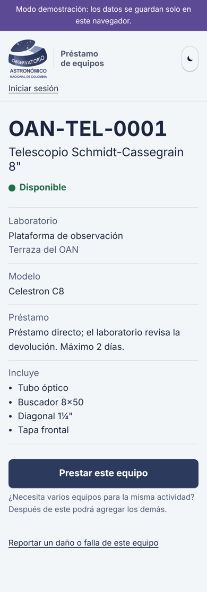
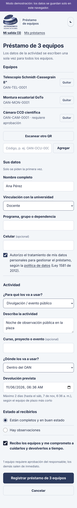
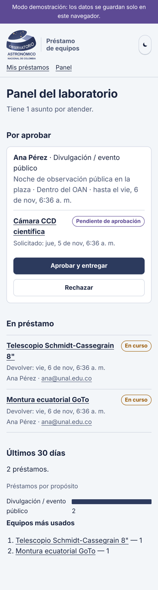
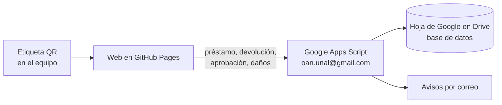

# Préstamo de equipos · Observatorio Astronómico Nacional

Sistema para registrar el préstamo y la devolución de los equipos de los laboratorios del Observatorio Astronómico Nacional (OAN) de la Universidad Nacional de Colombia.

Cada equipo lleva una etiqueta con un **código QR**. Quien lo saca lo escanea con el celular, dice para qué lo va a usar y cuándo lo devuelve, y el sistema guarda la **fecha y hora de salida**. Si una actividad necesita **varios equipos**, se escanean uno tras otro en el mismo formulario y los datos de la actividad se escriben una sola vez. Al devolverlo escanea el mismo QR, indica en qué estado lo entrega y se guarda la **fecha y hora de devolución**. Los responsables de cada laboratorio ven en un panel qué está prestado, a quién y para qué, y reciben avisos de vencimientos y daños.

<p>
  
  
  
</p>

**Web:** <https://astronomiaoan.github.io/equipos/> (en modo demostración hasta que se conecte el backend).

## Cómo funciona



- **Código, diseño y página web** viven en este repositorio y se publican gratis con GitHub Pages.
- **Los datos** (con nombres y correos) viven en una hoja de Google privada en el Drive de **oan.unal@gmail.com**, no en GitHub. Ver por qué en [opciones de implementación](docs/02-opciones-de-implementacion.md#por-qué-no-guardar-los-datos-en-github).

## Diseño del sistema

| | Documento |
| --- | --- |
| 1 | [Visión y alcance](docs/01-vision-y-alcance.md): problema, objetivos, roles y niveles de control |
| 2 | [Opciones de implementación](docs/02-opciones-de-implementacion.md): cuatro alternativas comparadas y recomendación |
| 3 | [Flujos de uso](docs/03-flujos.md): préstamo, devolución, aprobación y estados |
| 4 | [Códigos QR y etiquetas](docs/04-codigos-qr-y-etiquetas.md): codificación, material e impresión |
| 5 | [Modelo de datos](docs/05-modelo-de-datos.md): tablas, columnas y reglas de integridad |
| 6 | [Pantallas](docs/06-pantallas.md): cada vista de la web |
| 7 | [Reglas y notificaciones](docs/07-reglas-y-notificaciones.md): qué se valida y quién recibe qué correo |
| 8 | [Reportes e indicadores](docs/08-reportes-e-indicadores.md) |
| 9 | [Arquitectura y seguridad](docs/09-arquitectura-y-seguridad.md): autenticación, protección de datos, Ley 1581 |
| 10 | [Plan de implementación](docs/10-plan-de-implementacion.md): fases, costos y criterios de éxito |
| | [Guía rápida](docs/guia-rapida.md) para usuarios, responsables y administradores |
| | [Autorización de tratamiento de datos](docs/politica-de-datos.md) (borrador para revisión jurídica) |

## Contenido del repositorio

```text
├── docs/                  Diseño completo del sistema
├── web/                   Página que abren los QR (GitHub Pages)
├── apps-script/           Backend en Google Apps Script + pruebas
│   ├── Code.gs
│   └── pruebas/           Simulador de Google para probar con Node.js
├── herramientas/
│   └── generar_etiquetas.py   PDF de etiquetas QR listas para imprimir
├── datos/                 Plantillas CSV de equipos y laboratorios (ejemplo)
├── db/schema.sql          Esquema PostgreSQL para la fase 3
└── .github/workflows/     Publicación de la web y pruebas automáticas
```

## Puesta en marcha

1. **Probar la demostración:** active GitHub Pages (Settings → Pages → Source: **GitHub Actions**) y abra la web. Todo funciona con equipos de ejemplo guardados en el navegador.
2. **Activar la base de datos** que ya está creada en el Drive de oan.unal@gmail.com: [apps-script/README.md](apps-script/README.md).
3. **Conectar la web:** pegar la URL del backend en [`web/js/config.js`](web/js/config.js).
4. **Cargar el inventario** en la hoja `Equipos` e **imprimir las etiquetas**:

   ```bash
   pip install reportlab
   python herramientas/generar_etiquetas.py Equipos.csv
   ```

5. **Piloto** en un laboratorio y luego extender a todo el OAN ([plan](docs/10-plan-de-implementacion.md)).

## Desarrollo

```bash
node --test 'apps-script/pruebas/*.test.js'   # pruebas del backend
cd web && python3 -m http.server 8000         # web local en modo demostración
```

Para proponer cambios, abra un *issue* o un *pull request*. No suba exportaciones de la hoja con datos de usuarios.
