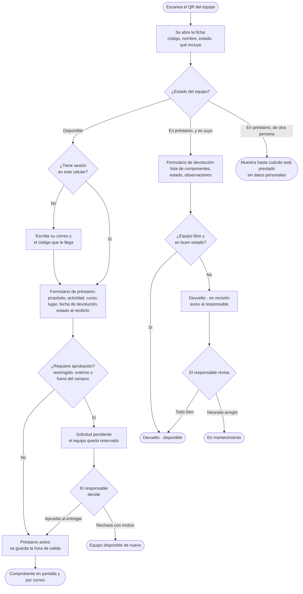
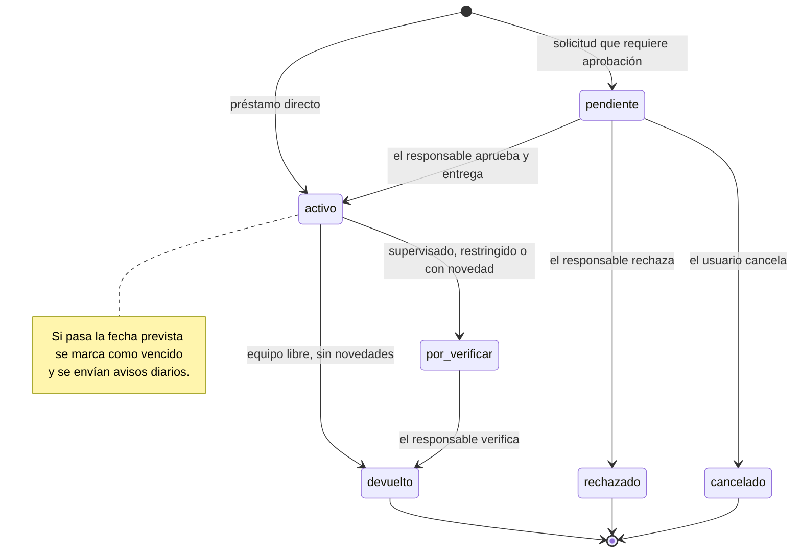
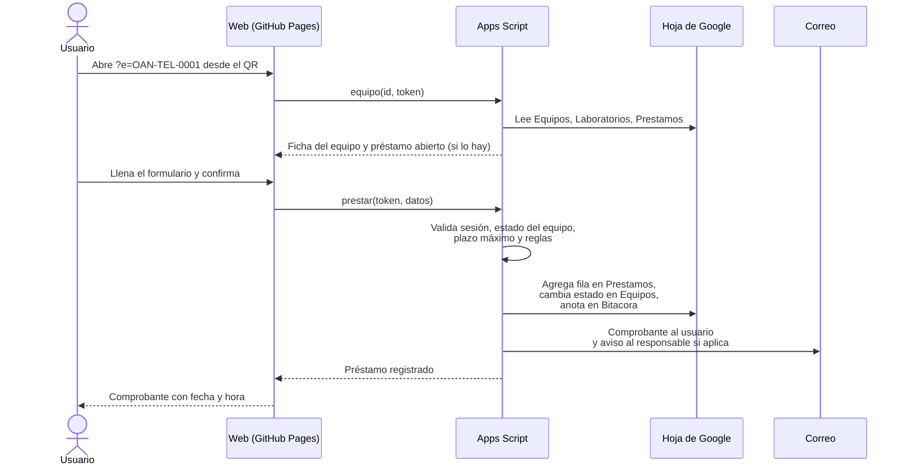

# 3. Flujos de uso

Todo empieza igual: la persona escanea el QR del equipo con la cámara del celular y se abre la ficha del equipo con su estado actual. Lo que puede hacer depende de ese estado y de quién es.

## Préstamo y devolución

## Estados de un préstamo

## Estados de un equipo

| Estado | Significado | Se puede prestar |
| --- | --- | --- |
| `disponible` | En su lugar, listo para usar | Sí |
| `reservado` | Hay una solicitud esperando aprobación | No |
| `prestado` | Alguien lo tiene | No |
| `en_revision` | Fue devuelto y el responsable debe revisarlo | No |
| `mantenimiento` | En reparación o calibración | No |
| `baja` | Retirado del inventario (no se imprimen etiquetas) | No |

El estado cambia solo con los movimientos. El administrador puede cambiarlo a mano en la hoja `Equipos` (por ejemplo, enviar a mantenimiento o dar de baja).

## Qué pasa por detrás al escanear

## Inicio de sesión

No se usan contraseñas. La primera vez, la persona escribe su correo, recibe un código de 6 dígitos y lo escribe en la página. Con eso el celular queda con una sesión firmada válida por 30 días. Así se confirma que el correo es suyo sin crear cuentas ni recordar claves. Los detalles están en [arquitectura y seguridad](09-arquitectura-y-seguridad.md).

## Situaciones especiales

| Situación | Cómo se resuelve |
| --- | --- |
| Alguien devuelve un equipo por otra persona | El responsable del laboratorio puede registrar la devolución desde la ficha del equipo; queda anotado quién la registró (`devuelto_por`) |
| El equipo se daña durante el préstamo | Se devuelve marcando «Dañado» y describiendo el daño; se crea un reporte y el equipo queda en revisión |
| Faltan piezas de un kit | Se desmarcan en la lista de componentes al devolver; se crea un reporte de faltante |
| Un equipo disponible tiene una falla | Cualquiera con sesión puede usar «Reportar un daño o falla» desde la ficha; el responsable recibe un correo |
| Se necesita más tiempo | El usuario devuelve y vuelve a prestar, o el responsable ajusta la `fecha_prevista` en la hoja |
| La etiqueta está dañada | En la página de inicio se puede escribir el código impreso; el administrador reimprime la etiqueta |
| Sin señal en la terraza de observación | La ficha necesita conexión. Se recomienda registrar la salida dentro del edificio, donde hay red |
