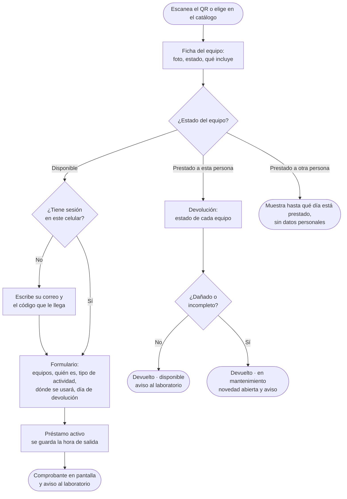
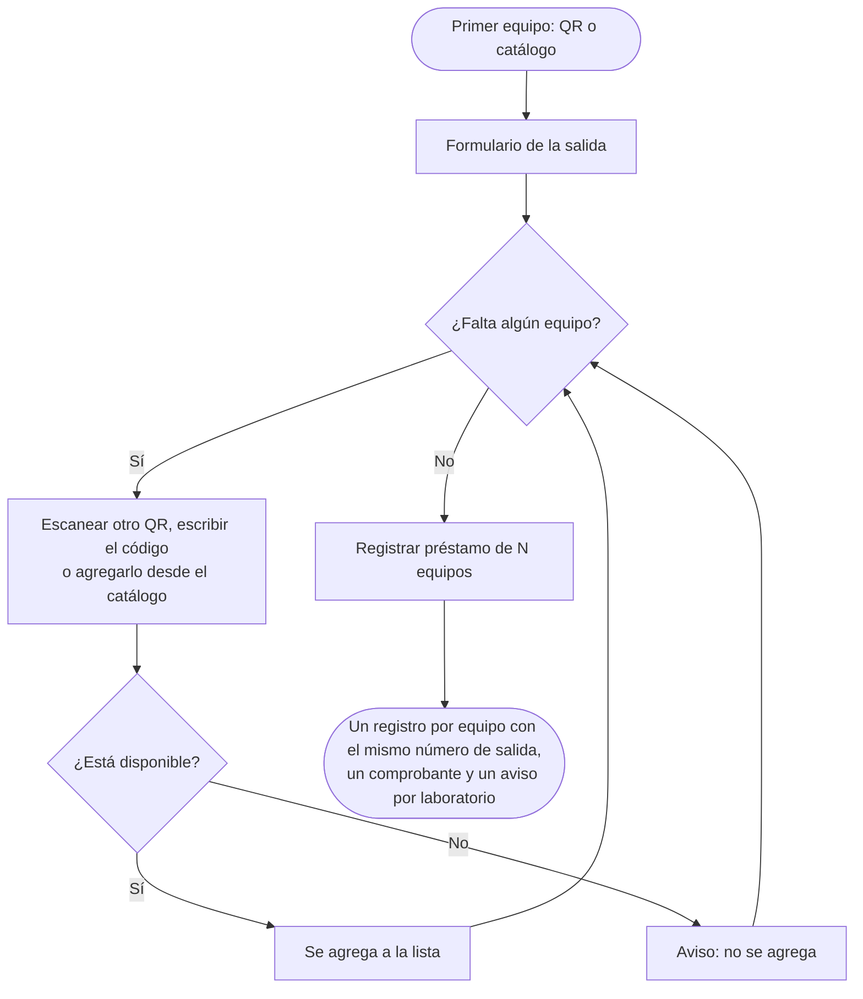
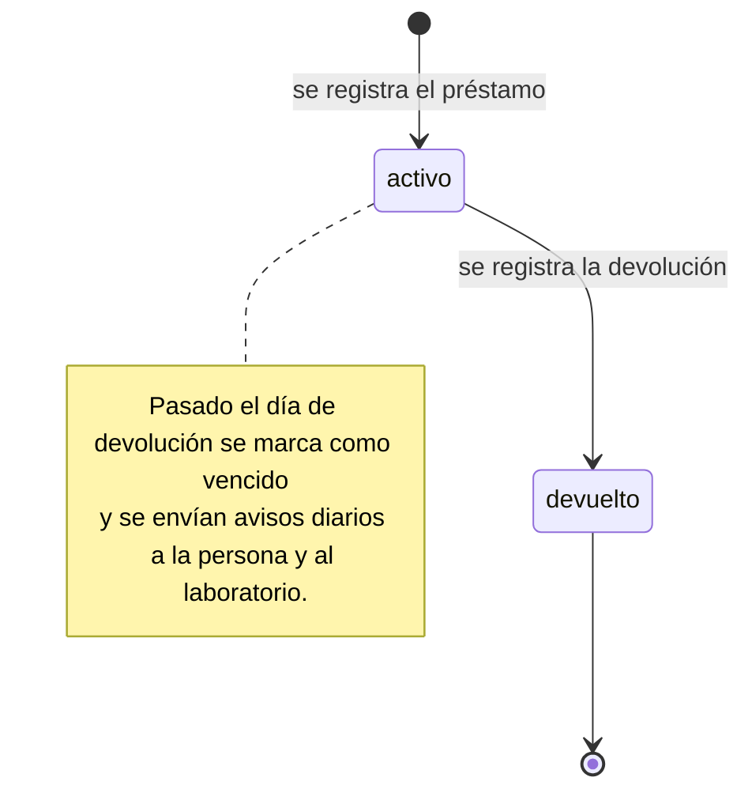
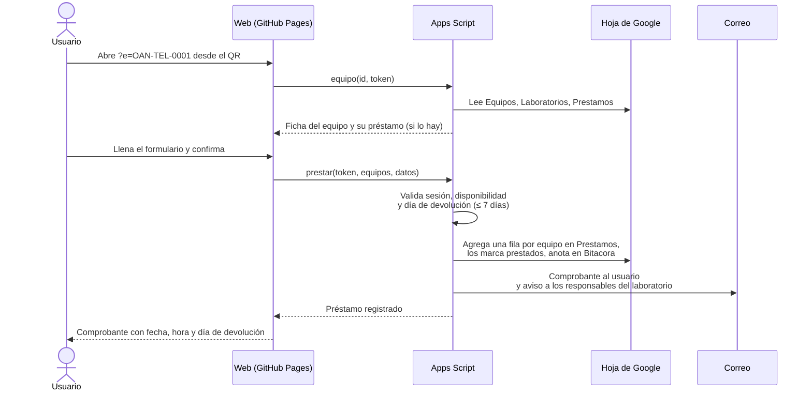

# 3. Flujos de uso

Todo empieza igual: la persona escanea el QR de un equipo con la cámara del celular, o lo elige en el catálogo, y se abre la ficha del equipo con su estado actual. **No hay aprobaciones ni verificaciones**: el préstamo y la devolución quedan registrados en el momento, y el laboratorio recibe el aviso.

## Préstamo y devolución

## Varios equipos para una misma actividad (salida)

Para una práctica o una noche de observación normalmente salen varios equipos juntos. La persona arma una **salida**: una lista de equipos con los datos de la actividad escritos una sola vez.

- El lector de QR dentro de la página **escanea seguido**: se apunta a un equipo, vibra al leerlo, y se apunta al siguiente.
- Lo escrito en el formulario se conserva mientras se agregan equipos.
- **Devolución:** desde «Mis préstamos» o desde el QR de cualquiera de los equipos se puede devolver **toda la salida** en un formulario, o **solo algunos** equipos; los demás siguen prestados.
- Cada equipo conserva su propio registro, así que el historial y las estadísticas por equipo siguen siendo exactos.

## Plazo: días calendario

- La persona elige el **día de devolución**: hoy, mañana o cualquier día hasta **7 días calendario** después (con atajos «Hoy», «Mañana», «En 3 días», «En una semana»).
- Cuentan todos los días, también fines de semana y festivos.
- El préstamo vence al **final de ese día** (11:59 p. m., hora de Colombia). Esa mañana llega un recordatorio; si pasa el día sin devolución, queda **vencido** y empiezan los avisos diarios.

## Estados de un préstamo

## Estados de un equipo

| Estado | Significado | Se puede prestar |
| --- | --- | --- |
| `disponible` | En su lugar, listo para usar | Sí |
| `prestado` | Alguien lo tiene | No |
| `mantenimiento` | Se devolvió dañado o incompleto, o está en reparación o calibración | No |
| `baja` | Retirado del inventario (no aparece en el catálogo ni se imprimen etiquetas) | No |

El estado cambia solo con los préstamos y devoluciones. Cuando el responsable marca como resuelta una novedad, puede dejar el equipo disponible otra vez. El administrador también puede cambiar el estado a mano en la hoja `Equipos`.

## Qué pasa por detrás al prestar

## Inicio de sesión

No se usan contraseñas. La primera vez, la persona escribe su correo, recibe un código de 6 dígitos y lo escribe en la página. Con eso el celular queda con una sesión firmada válida por 30 días. Los detalles están en [arquitectura y seguridad](09-arquitectura-y-seguridad.md).

## Situaciones especiales

| Situación | Cómo se resuelve |
| --- | --- |
| Alguien devuelve un equipo por otra persona | El responsable del laboratorio puede registrar la devolución desde la ficha del equipo; queda anotado quién la registró (`devuelto_por`) |
| El equipo se daña durante el préstamo | Se devuelve marcando «Dañado» y describiendo el daño; queda en mantenimiento y se abre una novedad |
| Faltan piezas | Se marca «Incompleto» y se describe lo que falta; queda en mantenimiento y se abre una novedad |
| Un equipo disponible tiene una falla | Cualquiera con sesión puede usar «Reportar un daño o falla» desde la ficha; el responsable recibe un correo |
| Se necesita más tiempo | Se devuelve y se vuelve a prestar, o el responsable ajusta la `fecha_prevista` en la hoja |
| La etiqueta está dañada | En la página de inicio se puede escribir el código impreso, o buscar el equipo en el catálogo |
| Sin señal en la terraza de observación | La ficha necesita conexión. Se recomienda registrar la salida dentro del edificio, donde hay red |
