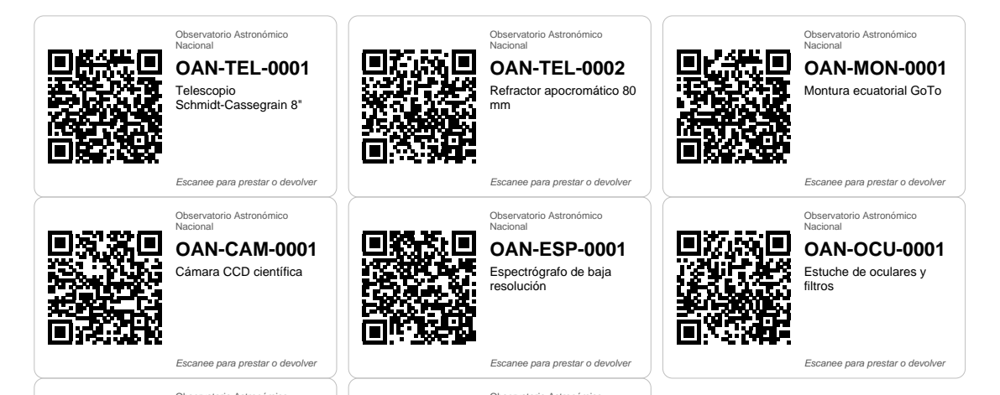

# 4. Códigos QR y etiquetas

## Qué contiene cada QR

Solo una dirección web con el código del equipo:

```text
https://astronomiaoan.github.io/equipos/?e=OAN-TEL-0001
```

El QR **no lleva datos personales ni información sensible**. Si en el futuro el sistema cambia de servidor, las etiquetas siguen sirviendo: basta con que esa dirección apunte al sistema nuevo.

## Código de cada equipo

Formato `OAN-<categoría>-<consecutivo de 4 dígitos>`. El código nunca se reutiliza, aunque el equipo se dé de baja.

| Código | Categoría |
| --- | --- |
| `TEL` | Telescopios y tubos ópticos |
| `MON` | Monturas y trípodes |
| `CAM` | Cámaras CCD y CMOS |
| `ESP` | Espectrógrafos y fotómetros |
| `OCU` | Oculares, filtros, lentes Barlow, reductores |
| `CMP` | Computadores y tabletas |
| `INS` | Instrumentos de medición y electrónica |
| `ACC` | Accesorios: cables, fuentes, baterías recargables |
| `DIV` | Kits de divulgación y material didáctico |

## Etiqueta física



- Debajo del QR va el **código legible**, para escribirlo a mano si la cámara no lee la etiqueta.
- **Material:** vinilo o poliéster laminado. El rocío y el frío de las noches de observación despegan y borran las etiquetas de papel.
- **Tamaño:** el QR de al menos 2 cm de lado. El formato `mediana` (63,5 × 38,1 mm) da un QR de 3,4 cm.
- **Ubicación:** superficie plana y visible, sin tapar la placa del fabricante, el número de serie ni las superficies ópticas. En telescopios, sobre el tubo cerca del enfocador; en monturas, en el cabezal.
- **Piezas pequeñas** (oculares, filtros): una etiqueta para el estuche, y el estuche completo se presta como un solo equipo, con sus piezas en la lista de componentes.
- **Kits:** una etiqueta para el kit y la lista de piezas en la columna `componentes`; al devolver, el sistema muestra esa lista para chequearla.

## Cómo imprimirlas

1. Exportar la hoja `Equipos` como CSV (Archivo → Descargar → Valores separados por comas).
2. Ejecutar:

   ```bash
   pip install reportlab
   python herramientas/generar_etiquetas.py Equipos.csv
   ```

3. Imprimir `etiquetas_qr.pdf` al **100 % (sin ajustar a la página)** sobre hojas adhesivas A4.

| Formato | Etiquetas por hoja | Medida | Uso |
| --- | --- | --- | --- |
| `mediana` (por defecto) | 21 | 63,5 × 38,1 mm | La mayoría de equipos |
| `grande` | 8 | 99,1 × 67,7 mm | Equipos grandes o vistos de lejos |
| `pequena` | 40 | 48,5 × 25,4 mm | Estuches y piezas pequeñas |

Otras opciones útiles: `--solo OAN-CAM-0001 OAN-ESP-0001` para reimprimir algunas, `--desde 8` para empezar en la etiqueta 8 de una hoja ya usada, `--sin-bordes` en hojas precortadas. Los equipos en estado `baja` se omiten.

Antes de pegar las etiquetas, conviene escanear dos o tres con un celular para confirmar que abren la ficha correcta.
