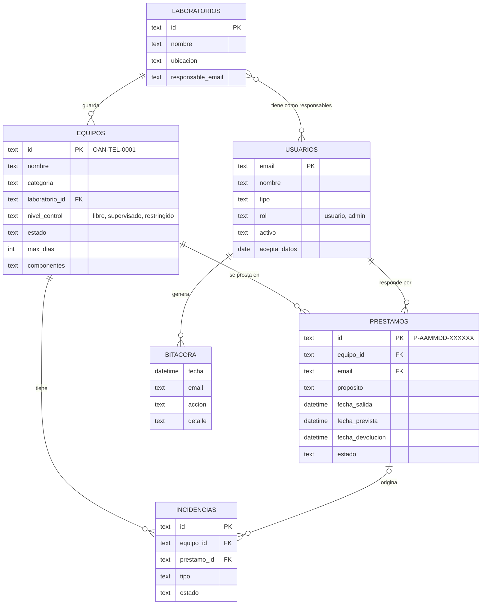

# 5. Modelo de datos

En la fase 1 la base de datos es una hoja de cálculo de Google con una pestaña por tabla. Los nombres de pestañas y columnas son exactamente los que usa [`apps-script/Code.gs`](../apps-script/Code.gs); la función `configurar()` las crea. El mismo modelo está en PostgreSQL en [`db/schema.sql`](../db/schema.sql) para la fase 3.

## Pestañas y columnas

### `Equipos` — la llena el administrador

| Columna | Ejemplo | Notas |
| --- | --- | --- |
| `id` | `OAN-TEL-0001` | Código del QR. Único, nunca se reutiliza |
| `nombre` | Telescopio Schmidt-Cassegrain 8" | Como lo reconoce la gente |
| `categoria` | Telescopios | |
| `laboratorio_id` | `LAB-OBS` | Debe existir en `Laboratorios` |
| `marca`, `modelo`, `serie` | Celestron, C8, … | |
| `nivel_control` | `supervisado` | `libre`, `supervisado` o `restringido` (lista desplegable) |
| `estado` | `disponible` | Lo actualiza el sistema; ver [flujos](03-flujos.md#estados-de-un-equipo) |
| `max_dias` | 2 | Plazo máximo de un préstamo. Vacío = 7 |
| `componentes` | Tubo óptico; Buscador; Tapa | Separados por punto y coma. Se chequean al devolver |
| `notas` | Guardar con desecante | Se muestra en la ficha |

### `Laboratorios` — la llena el administrador

| Columna | Ejemplo | Notas |
| --- | --- | --- |
| `id` | `LAB-OPT` | |
| `nombre` | Laboratorio de Óptica e Instrumentación | |
| `ubicacion` | Edificio del OAN, primer piso | Se muestra en la ficha |
| `responsable_email` | tecnico@unal.edu.co, docente@unal.edu.co | Uno o varios, separados por coma. Reciben avisos y ven el panel |

### `Usuarios` — se llena sola la primera vez que alguien presta

| Columna | Notas |
| --- | --- |
| `email` | Identificador; se verifica con el código enviado |
| `nombre`, `tipo`, `dependencia`, `telefono` | Los escribe la persona. `tipo`: estudiante de pregrado o posgrado, docente, investigador, personal técnico o administrativo, externo |
| `rol` | `usuario` por defecto. Escribir `admin` para dar acceso a todos los laboratorios |
| `activo` | Escribir `NO` para bloquear a alguien |
| `acepta_datos` | Fecha en que autorizó el tratamiento de datos |
| `fecha_registro` | |

### `Prestamos` — la llena el sistema

| Columna | Notas |
| --- | --- |
| `id` | `P-251105-3F9A1C` |
| `equipo_id`, `email` | Quién y qué |
| `nombre`, `tipo_usuario` | Copia al momento del préstamo, para que el historial no cambie si la persona edita su perfil |
| `proposito` | Docencia (clase), Práctica de laboratorio, Investigación / tesis, Observación astronómica, Divulgación / evento público, Mantenimiento o calibración, Otro |
| `descripcion`, `curso_proyecto` | Para qué exactamente |
| `lugar_uso` | Dentro del OAN, Campus universitario, Fuera del campus |
| `avalista_email` | Solo para usuarios externos |
| `fecha_solicitud` | Cuando se llenó el formulario |
| `fecha_salida` | **Cuando el equipo salió**: al registrar (préstamo directo) o al aprobar (con aprobación) |
| `fecha_prevista` | Devolución acordada; no puede pasar de `max_dias` |
| `fecha_devolucion` | **Cuando se devolvió** |
| `estado` | `pendiente`, `activo`, `por_verificar`, `devuelto`, `rechazado`, `cancelado` |
| `condicion_salida`, `condicion_devolucion`, `obs_devolucion`, `componentes_ok` | Estado del equipo al salir y al volver |
| `devuelto_por`, `aprobado_por`, `motivo_rechazo`, `verificado_por`, `fecha_verificacion` | Trazabilidad de quién hizo qué |
| `recordatorio_enviado` | Para no repetir el aviso previo al vencimiento |

### `Incidencias` — daños, faltantes y fallas

`id`, `equipo_id`, `prestamo_id`, `email`, `tipo` (Daño, Faltante, Falla de funcionamiento, Requiere calibración, Otro), `descripcion`, `fecha`, `estado` (`abierta`/`cerrada`), `resuelto_por`, `fecha_cierre`, `solucion`.

### `Bitacora` — registro de auditoría

Cada inicio de sesión, préstamo, aprobación, devolución y reporte queda con `fecha`, `email`, `accion` y `detalle`. No se edita a mano.

## Reglas de integridad

- Un equipo tiene **como máximo un préstamo abierto** (`pendiente`, `activo` o `por_verificar`). En la hoja lo garantiza el bloqueo de Apps Script; en PostgreSQL, un índice único parcial.
- Los textos escritos por los usuarios que empiezan por `=`, `+`, `-` o `@` se guardan con un apóstrofo delante, para que la hoja no los interprete como fórmulas.
- Se pueden agregar columnas propias al final de cualquier pestaña (por ejemplo `placa_inventario` en `Equipos`); el sistema las respeta.
