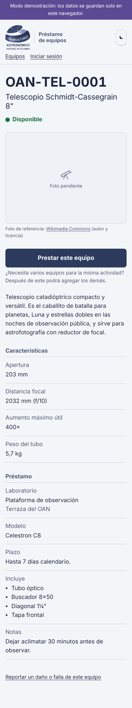
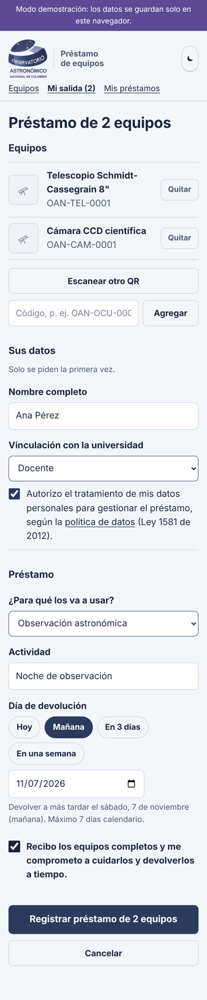
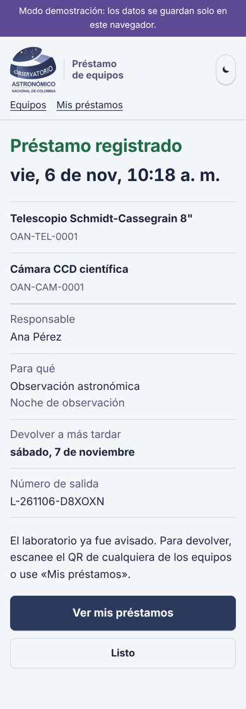
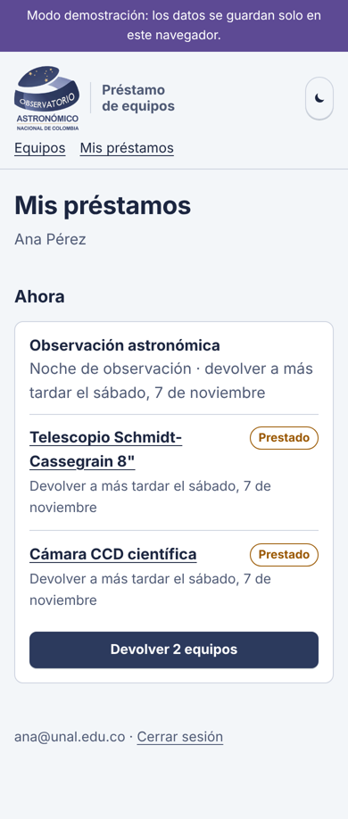
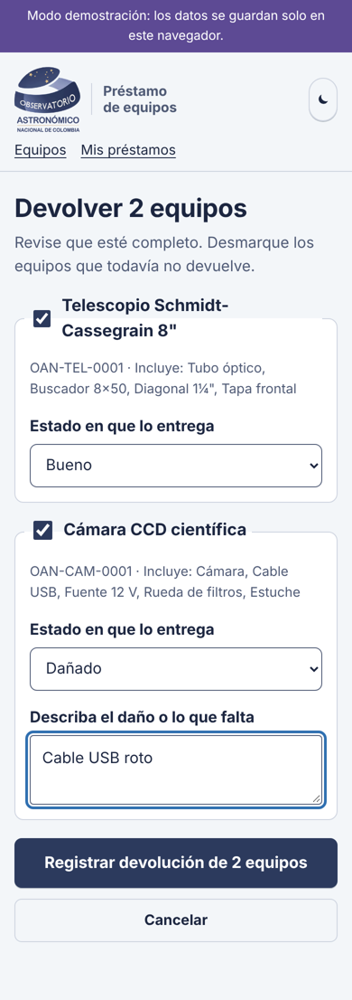
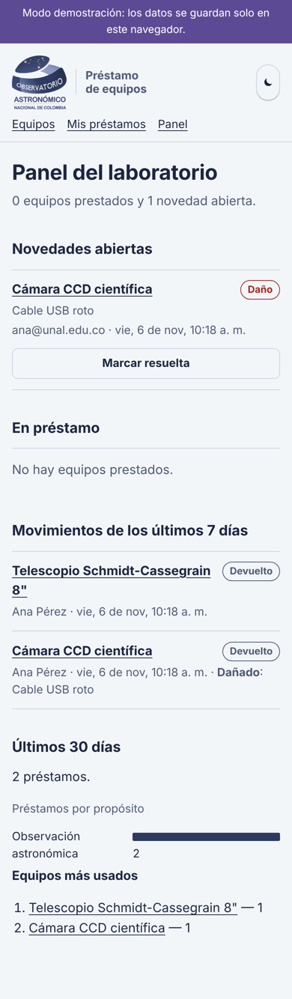
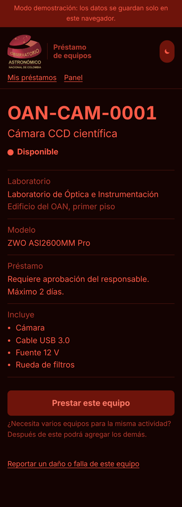
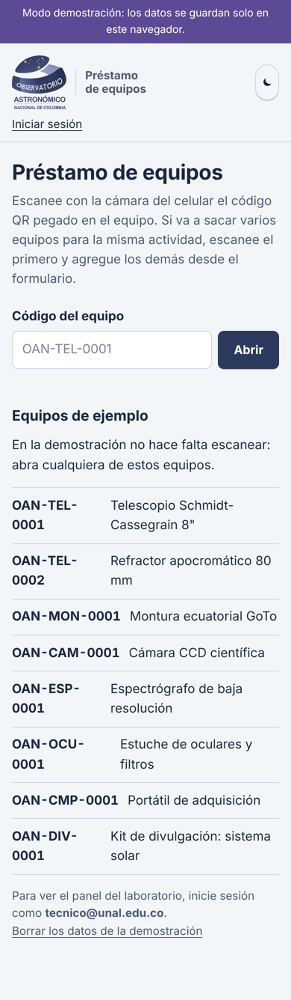

# 6. Pantallas

La web está pensada para el celular, que es lo que la gente tiene en la mano cuando escanea un QR. Funciona igual en un computador. Las capturas son del [modo demostración](../web/README.md).

## Catálogo de equipos

Menú **Equipos** (siempre visible arriba). Muestra todos los equipos que no están dados de baja, en tarjetas con:

- **foto**, código, nombre, marca y modelo, y el comienzo de la descripción;
- **disponibilidad**: «Disponible», «Prestado hasta el 7 nov.», «En mantenimiento»…, sin mostrar quién lo tiene;
- el botón **Agregar a la salida**, para armar desde aquí una salida de varios equipos. Abajo aparece una barra «Su salida: N equipos · Continuar con el préstamo».

Arriba hay un buscador (por nombre, código, marca o uso; no importan las tildes), filtros por **categoría** y **laboratorio**, y la casilla **Solo disponibles**. En el celular las tarjetas van en una columna; en el computador, en varias. En el modo de luz roja las fotos se tiñen de rojo oscuro.

## Ficha del equipo (lo que abre el QR)

Lo más grande es el código del equipo, para que la persona confirme de un vistazo que abrió el equipo que tiene en la mano. Debajo van el estado, la **foto** (con su crédito), el botón de acción, la **descripción**, la tabla de **características** y los datos de préstamo: laboratorio, condiciones y lo que incluye. Hay **un solo botón principal**, que cambia según el estado: «Prestar este equipo», «Agregar a mi salida» o «Devolver este equipo» (para el responsable, «Registrar la devolución»).

## Formulario de préstamo (uno o varios equipos)

- **Equipos**: la lista de lo que sale, con «Quitar» en cada uno, el botón **Escanear otro QR** (abre la cámara dentro de la página y lee varios QR seguidos) y un campo para escribir un código.
- **Sus datos** solo aparece la primera vez: nombre, vinculación y la autorización de tratamiento de datos.
- **Préstamo**, una sola vez para todos los equipos: para qué (lista), la actividad en pocas palabras y el **día de devolución**, con atajos «Hoy», «Mañana», «En 3 días» y «En una semana» (máximo 7 días calendario).
- La casilla de compromiso. No hay campos opcionales ni aprobación: al registrar, el préstamo queda activo.

## Comprobante

Muestra la fecha y hora registradas y el número de préstamo. La misma información llega por correo.

## Mis préstamos

Lo que la persona tiene ahora, **agrupado por salida**, con el botón «Devolver N equipos», y su historial.

## Devolución de varios equipos

Un bloque por equipo con lo que incluye y el estado en que se entrega («Bueno» por defecto). Solo si se marca «Dañado» o «Incompleto» aparece el campo para describir el problema. Se desmarcan los equipos que todavía no se devuelven.

## Panel del laboratorio

Solo para responsables y administradores. Es donde «llegan» los préstamos y devoluciones, además del aviso por correo. En orden: préstamos **vencidos**, **novedades** abiertas (daños y faltantes, con el botón «Marcar resuelta»), equipos **en préstamo** agrupados por salida (quién, para qué y hasta qué día), **movimientos de los últimos 7 días** y un resumen de los últimos 30 días.

## Logo

La cabecera, los correos y las etiquetas llevan el logo del Observatorio. Sobre fondo claro se usa la versión con letras azules ([`web/img/logo-claro.png`](../web/img/logo-claro.png)); sobre fondo oscuro, la de letras blancas ([`web/img/logo-oscuro.png`](../web/img/logo-oscuro.png)), que en el modo de luz roja se tiñe de rojo tenue.

## Modo de luz roja

Durante la observación, una pantalla blanca arruina la adaptación del ojo a la oscuridad, por eso los observadores usan linternas rojas. El botón de la luna cambia toda la interfaz a rojo tenue sobre negro y el celular recuerda la preferencia.

## Inicio

Para quien llega sin escanear: un campo para escribir el código impreso bajo el QR.

## Criterios de diseño

- **Menos de un minuto** para un préstamo de alguien que ya está registrado: 4 campos obligatorios y 2 casillas.
- Tipografía [Atkinson Hyperlegible](https://www.brailleinstitute.org/freefont/), diseñada para máxima legibilidad.
- Botones de al menos 48 px de alto, foco visible con teclado, textos de error que dicen qué corregir.
- La ficha pública **no muestra quién tiene el equipo**; solo la fecha de devolución. El nombre y el correo los ven el propio usuario y el responsable.
