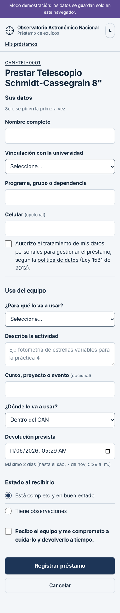

# 6. Pantallas

La web está pensada para el celular, que es lo que la gente tiene en la mano cuando escanea un QR. Funciona igual en un computador. Las capturas son del [modo demostración](../web/README.md).

## Ficha del equipo (lo que abre el QR)

Lo más grande es el código del equipo, para que la persona confirme de un vistazo que abrió el equipo que tiene en la mano. Debajo, el estado con un indicador de color, el laboratorio, las condiciones de préstamo y lo que incluye. Hay **un solo botón principal**, que cambia según el estado: «Prestar este equipo», «Devolver este equipo» o, para el responsable, «Aprobar y entregar» o «Revisado: queda disponible».

## Formulario de préstamo

- **Sus datos** solo aparece la primera vez: nombre, vinculación, dependencia, celular (opcional) y la autorización de tratamiento de datos.
- **Uso del equipo**: propósito (lista), descripción de la actividad, curso o proyecto, lugar de uso y fecha y hora de devolución (limitada al plazo máximo del equipo).
- **Estado al recibirlo** y la casilla de compromiso.
- Si el préstamo requiere aprobación, el botón cambia a «Enviar solicitud» y se explica por qué.

## Comprobante

Muestra la fecha y hora registradas y el número de préstamo. La misma información llega por correo.

## Mis préstamos

Lo que la persona tiene ahora y su historial, con los vencidos resaltados.

## Panel del laboratorio

Solo para responsables y administradores. En orden de urgencia: solicitudes por aprobar, devoluciones por verificar, préstamos vencidos, equipos prestados, reportes de daño abiertos y un resumen de los últimos 30 días (préstamos por propósito y equipos más usados). Todas las acciones se hacen desde aquí sin abrir la hoja de cálculo.

## Modo de luz roja

Durante la observación, una pantalla blanca arruina la adaptación del ojo a la oscuridad, por eso los observadores usan linternas rojas. El botón de la luna cambia toda la interfaz a rojo tenue sobre negro y el celular recuerda la preferencia.

## Inicio

Para quien llega sin escanear: un campo para escribir el código impreso bajo el QR.

## Criterios de diseño

- **Menos de un minuto** para un préstamo de alguien que ya está registrado: 4 campos obligatorios y 2 casillas.
- Tipografía [Atkinson Hyperlegible](https://www.brailleinstitute.org/freefont/), diseñada para máxima legibilidad.
- Botones de al menos 48 px de alto, foco visible con teclado, textos de error que dicen qué corregir.
- La ficha pública **no muestra quién tiene el equipo**; solo la fecha de devolución. El nombre y el correo los ven el propio usuario y el responsable.
