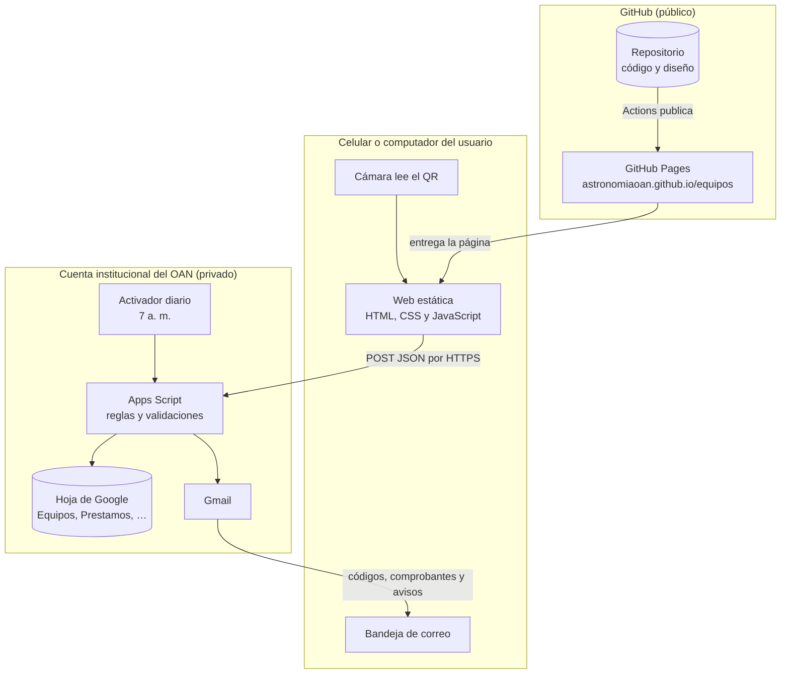

# 9. Arquitectura y seguridad

## Componentes

| Componente | Dónde vive | Qué hace |
| --- | --- | --- |
| Web ([`web/`](../web)) | GitHub Pages (gratis) | Muestra la ficha del equipo y los formularios. No guarda datos salvo la sesión del propio usuario en su navegador |
| Backend ([`apps-script/Code.gs`](../apps-script/Code.gs)) | Google Apps Script, en la cuenta del OAN | Recibe las acciones, valida reglas, escribe en la hoja y envía correos |
| Base de datos | Hoja de Google en el Drive del OAN | Seis pestañas; ver [modelo de datos](05-modelo-de-datos.md) |
| Etiquetas ([`herramientas/`](../herramientas)) | Computador de quien imprime | Genera el PDF con los QR |

La web y el backend se comunican con peticiones `POST` cuyo cuerpo es JSON enviado como `text/plain`, porque Apps Script no responde a las consultas previas (CORS *preflight*) que hace el navegador con `application/json`.

## Identificación de usuarios

- **Sin contraseñas.** La persona escribe su correo y recibe un código de 6 dígitos. Así se comprueba que el correo es suyo.
- El código se guarda como **resumen SHA-256** (no en claro) en la caché de Apps Script, **vence a los 10 minutos** y se invalida tras **5 intentos fallidos**. Se pueden pedir máximo 3 códigos cada 10 minutos.
- Al validar el código, el servidor entrega un **token firmado con HMAC-SHA256** que contiene el correo y la fecha de vencimiento (30 días). La clave de firma (`SECRETO_TOKEN`) está en las propiedades del script y nunca sale del servidor. Un token alterado o vencido se rechaza.
- **Cerrar todas las sesiones** (menú de la hoja) cambia la clave y obliga a todos a ingresar de nuevo. Para bloquear a una persona, `activo = NO` en `Usuarios`.
- Los roles no se guardan en el token: en cada acción se consultan las hojas `Usuarios` y `Laboratorios`, así que quitar a un responsable tiene efecto inmediato.

## Protección de los datos

| Riesgo | Medida |
| --- | --- |
| Que cualquiera vea quién tiene un equipo | La ficha pública solo muestra el estado y la fecha de devolución. Nombre, correo y propósito los ven el titular del préstamo y los responsables |
| Que alguien registre préstamos a nombre de otro | Cada acción exige un token válido; el correo sale del token, no del formulario |
| Que dos personas presten el mismo equipo a la vez | Todas las escrituras usan `LockService` y se revalida el estado del equipo dentro del bloqueo |
| Inyección de fórmulas en la hoja | Los textos que empiezan por `=`, `+`, `-` o `@` se guardan como texto |
| Inyección de HTML en correos y en la web | Todo dato de usuario se escapa antes de mostrarse |
| Acceso a la hoja | La hoja se comparte **solo** con administradores y responsables. El Apps Script se publica «ejecutar como: yo» y no da acceso a la hoja |
| Pérdida de datos | El historial de versiones de Google conserva los cambios; se recomienda una copia mensual (Archivo → Hacer una copia) |
| Datos de más | Solo se piden nombre, vinculación, dependencia y, opcionalmente, celular. No se piden documento de identidad ni dirección |

## Ley 1581 de 2012 (protección de datos personales)

- La primera vez, el usuario **autoriza expresamente** el tratamiento de sus datos; la fecha queda en `acepta_datos`.
- La finalidad es solo gestionar préstamos, devoluciones y la conservación de los equipos.
- El texto de la autorización enlaza a [`politica-de-datos.md`](politica-de-datos.md), que es una **propuesta que debe revisar la oficina jurídica** y alinearse con la política institucional de la universidad.
- Para consultas, rectificación o supresión, el administrador edita o elimina las filas de la persona en `Usuarios`; los préstamos se pueden anonimizar reemplazando nombre y correo.

## Límites conocidos de la fase 1

- Apps Script tarda entre 1 y 3 segundos por petición; es aceptable para formularios.
- Una hoja de Google funciona bien hasta decenas de miles de filas. Con el ritmo previsible del OAN eso son varios años; antes de llegar ahí, conviene pasar a la fase 3.
- La web necesita conexión a internet.
