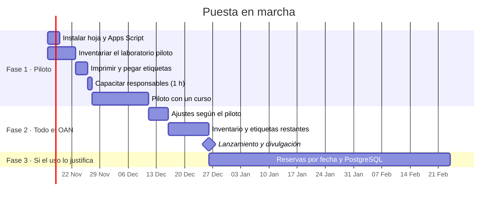

# 10. Plan de implementación

Las fechas son de referencia: el piloto puede empezar en cuanto se defina el laboratorio.

## Fase 1 · Piloto en un laboratorio (4–5 semanas)

1. **Instalar** el backend y conectar la web siguiendo [`apps-script/README.md`](../apps-script/README.md) (una tarde).
2. **Inventariar** los equipos del laboratorio piloto en la hoja `Equipos`, empezando por los que más se prestan. Decidir con el responsable el `nivel_control` y el `max_dias` de cada uno.
3. **Imprimir y pegar** las etiquetas ([guía](04-codigos-qr-y-etiquetas.md)).
4. **Capacitar** a los responsables con la [guía rápida](guia-rapida.md) y la web en modo demostración.
5. **Piloto** con un curso o grupo durante dos semanas. Medir: ¿cuánto tarda un préstamo?, ¿cuántas salidas no se registraron?, ¿qué campos sobran o faltan?

## Fase 2 · Todos los laboratorios (3 semanas)

1. Ajustar formularios, plazos y niveles con lo aprendido.
2. Inventario y etiquetas del resto de laboratorios.
3. Divulgación: correo a estudiantes y docentes, aviso en los laboratorios con un QR general a la página de inicio, y la regla de que **ningún equipo sale sin escanear su QR**.
4. Instalar la alerta diaria y revisar el panel cada semana.

## Fase 3 · Mejoras (cuando el uso lo justifique)

- Reservas anticipadas por fecha y hora (por ejemplo, el telescopio para la noche del viernes), con calendario.
- Migrar a PostgreSQL ([`db/schema.sql`](../db/schema.sql)) con un backend propio o Supabase.
- Inicio de sesión con la cuenta institucional de Google (SSO) en lugar del código por correo.
- Registro de mantenimientos y calibraciones con recordatorios periódicos.
- Fotografía del estado del equipo al devolverlo.

## Responsables sugeridos

| Tarea | Quién |
| --- | --- |
| Dueño del sistema y de la hoja | Coordinación de laboratorios del OAN |
| Instalación técnica y mantenimiento del código | Un técnico o monitor con conocimientos básicos de JavaScript |
| Inventario y etiquetas | Responsable de cada laboratorio |
| Revisión de la política de datos | Oficina jurídica de la universidad |

## Costos estimados

| Concepto | Costo aproximado |
| --- | --- |
| GitHub Pages, Apps Script, Hoja de Google | Sin costo con las cuentas institucionales |
| Etiquetas de vinilo laminado A4 (21 por hoja) | Del orden de algunos miles de pesos por hoja; unas 10 hojas para 200 equipos |
| Tiempo de inventario | Unos 5 minutos por equipo |
| Tiempo de instalación | Una tarde |

## Criterios de éxito del piloto

- Al menos el 90 % de las salidas del laboratorio piloto quedan registradas.
- Un préstamo de un usuario ya registrado toma menos de un minuto.
- Los responsables saben en todo momento dónde está cada equipo sin preguntar.
